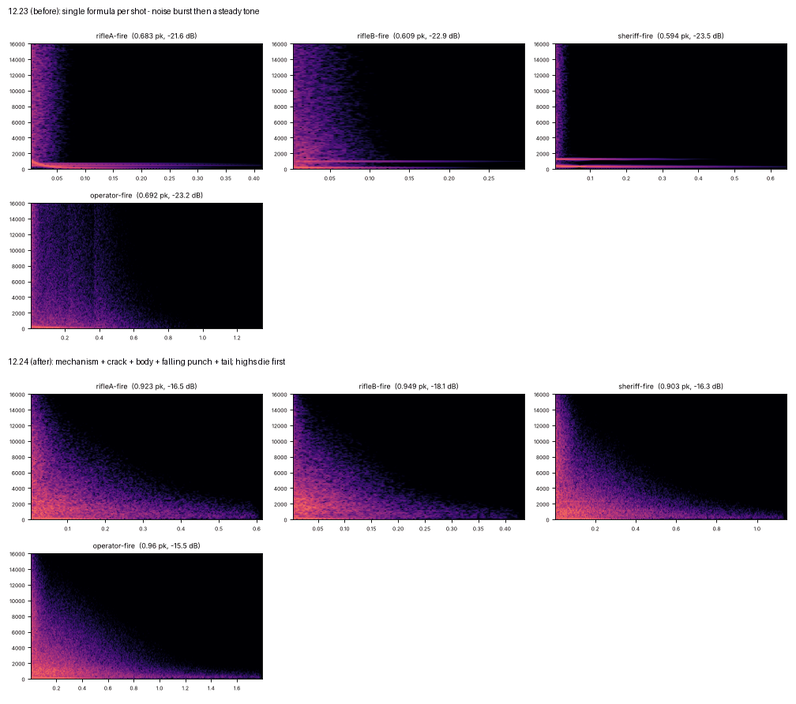
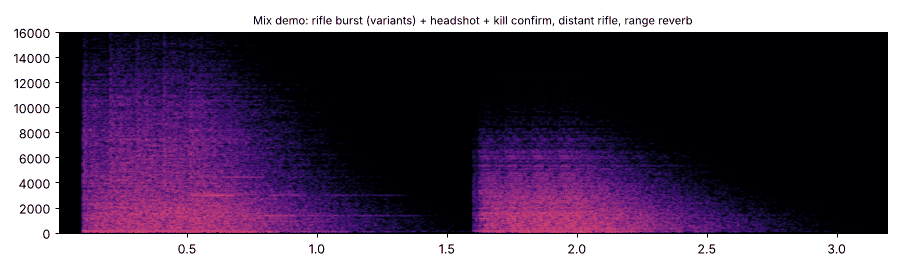

# Audio overhaul — 12.24

Every sound in the browser game is still synthesised in code; no recordings
from any game or library are used. 12.24 replaces the one-line formulas with a
layered sound design modelled on how shooter audio is built, plus a mix bus,
room reverb and distance cues.

## What other shooters do (sources)

- **Weapon layering.** Game weapon sounds are split into mechanism/transient,
  body, low punch/sub and tail layers; the dry gun is kept separate from the
  environment tail so the engine can add the room per level, with tail
  variants for indoor, outdoor and distance. One sample played repeatedly
  "doesn't sound very good" — sounds cycle through variations (round robin).
  ([Splice](https://splice.com/blog/?p=16617),
  [Krotos](https://www.krotosaudio.com/?p=1057976),
  [Lior Tega](https://www.liortega.com/post/first-person-shooter-gun-sound-design))
- **VALORANT.** The audio director says footsteps are optimised to be heard
  rather than to portray distance, with a deliberately flat attenuation curve;
  surface foley (footsteps, bodyfalls, shells) was recorded per surface, and
  third-person weapon sounds change with direction of fire.
  ([Ask VALORANT #6](https://playvalorant.com/en-gb/news/game-updates/ask-valorant-6/),
  [How the VALORANT Arsenal was built](https://playvalorant.com/en-us/news/dev/how-the-valorant-arsenal-was-built/))
- **CS2.** Positional (HRTF) audio is always on, and hit feedback timing is
  treated as important enough to patch (body-shot impact sound delay reduced).
  ([CSDB audio guide](https://csdb.gg/guides/audio-guide/),
  [Dust2.us](https://dust2.us/news/61434/cs2-may-5-15-update-finally-fixes-body-shot-sound-delays))

## What 12.23 had

- Gunshots: a noise burst followed by a **steady sine tone that lasted the
  whole sound** (600 Hz–1.1 kHz; two tones for 0.6 s on the Sheriff) — a buzz,
  not a shot. One buffer per weapon, mono, no room.
- Reload, bolt and scope: clicks of high-pass noise (spectral centroid
  9–10 kHz), i.e. hiss.
- Headshot: two high sines; body hit: the weapon's *equip* sound at 35 %.
- Footsteps: centroid ~4.9 kHz, two variants.

## What 12.24 does

**Toolkit** (`src/engine/audio/dsp.ts`): seeded noise, RBJ biquads, damped
modal resonators (metal, wood, polymer), falling-pitch punch, saturation,
synthesised stereo room responses.

**Weapons** (`synthesis.ts`): five layers per shot — mechanism click, muzzle
crack (sub-ms attack), mid body, falling-pitch low punch with a thump, short
dry tail — every layer normalised before mixing so recipe levels are true
relative levels. Four round-robin variants (±2.5 % pitch, ±0.7 dB, mechanism
timing). First person is stereo (decorrelated body/tail, centred transient);
other shooters get mono third-person variants without the mechanism and with
less high end.

| Shot | centroid (Hz) | crest (dB) | −40 dB decay (ms) | stereo width | sub < 150 Hz |
|---|---|---|---|---|---|
| Vandal | 284 → 859 | 18.3 → 16.0 | 285 → 510 | 0 → 0.15 | 49 % → 28 % |
| Phantom | 494 → 1164 | 18.6 → 17.6 | 180 → 275 | 0 → 0.12 | 73 % → 19 % |
| Sheriff | 288 → 774 | 18.9 → 15.8 | 500 → 740 | 0 → 0.20 | 0 % → 21 % |
| Operator | 1088 → 625 | 20.0 → 15.6 | 575 → 1080 | 0 → 0.24 | 51 % → 28 % |

(Rendered at 48 kHz, `scripts/audio/render.mjs` + `analyze.py`.)

**Handling foley:** reloads are timed sequences of magazine release click,
mid-band slide, seat "clack" (modal metal plus polymer knock) and charging
handle; the Sheriff opens the cylinder, ejects six cases and snaps shut; the
Operator bolt lifts, racks, ejects and locks. Equip adds cloth and a handling
clack.

**Feedback:** headshot is a short inharmonic metallic "dink" (centroid
1.1 kHz → 3.1 kHz, decays in 180 ms); body hits a dull thwack (centroid
~170 Hz); every elimination plays a two-note confirm that rises a whole tone
per consecutive kill within 2.5 s (up to four steps), including knife kills.

**Footsteps and landings:** heel then toe 30–40 ms apart, sole scuff in the
250 Hz–4 kHz band, floor-specific resonances (steel grating rings, wood is
hollow, glass bright), four variants per surface; landings add a body drop and
a gear rattle. Concrete step centroid 4.9 kHz → 2.1 kHz.

**Impacts:** masonry cracks and sheds sparse grit, metal pings
inharmonically, wood knocks and splinters, glass cracks and tinkles; exits are
quieter and duller. All stay under 0.25 s and below 0.6 peak.

**Mix (`Audio.ts`):** channel buses → glue compressor (−16 dB, 3:1) →
limiter (−1.5 dB). A convolution reverb with a synthesised response per map
type (range 1.15 s, courtyard 0.8 s, indoor 0.52 s with dense early
reflections). Distant sources send more to the room, and their open low-pass
cutoff falls with distance (air absorption, ≥2.8 kHz). Footsteps use a flatter
3D roll-off than gunfire so they stay audible, following VALORANT's stated
priority.

**Loading:** sounds render in a Web Worker while the training briefing is
open (equipped weapon, room, feedback and footsteps first), then become
AudioBuffers on unlock. Without a worker a sound renders on first use. In a
production-build session no main-thread task over 50 ms occurred after
training started.

Imported, rights-cleared recordings (Settings → Sound) still replace the
procedural fire (all variants) and headshot sounds.

## Not verified

Listening tests with people, headphone localisation, and comparison against
recordings of any game. The measurements above describe the signals, not how
good they sound to players.
