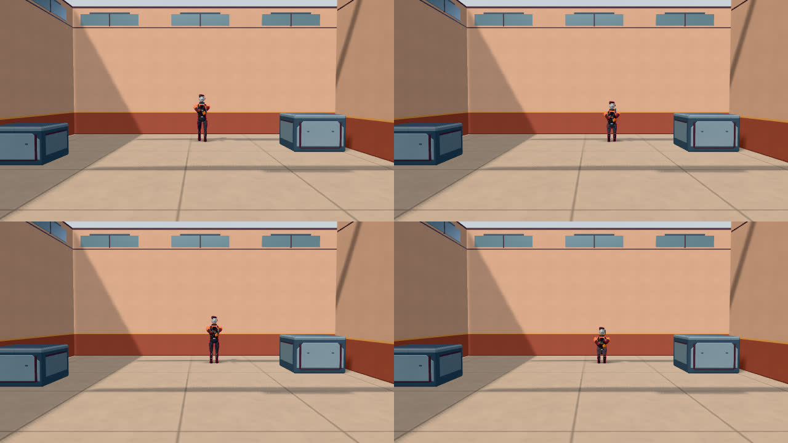
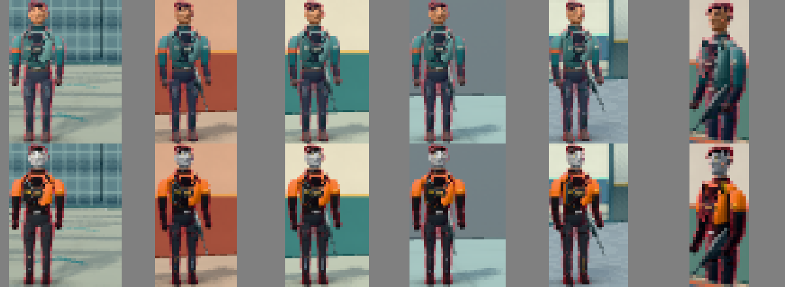
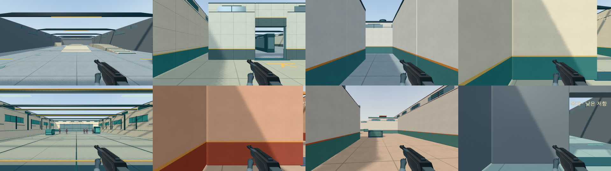

# 상대 봇 무빙과 연습 봇 외형 (12.40)

작성일: 2026-11-28

## 1. 봇 무빙 9가지

전술 맵(수비수가 있는 맵)의 설정 → 훈련 환경 세부 설정 → "상대 봇 무빙 · 외형"에서 고릅니다.
- **기본**: 이전과 같은 AI입니다. 자리를 지키다 재배치합니다.
- **무작위**: 봇마다 9가지 중 하나를 고릅니다.
- **스타일 지정**: 고른 스타일로 모든 봇이 움직입니다.

### 1.1 공통 동작

1. **엄폐물 찾기**: 지키는 각의 좌우 0.9m 지점에서 정면 10m 지점이 보이는지 검사합니다. 가려지는 쪽을 엄폐물 쪽으로 정합니다. 양쪽 다 보이면 열린 곳으로 봅니다.
2. **숨기 → 피킹 → 돌아오기**
   - 엄폐물 뒤에서 기다리다 반대쪽으로 피킹합니다.
   - 플레이어를 보거나 듣지 못했으면 2.5배 더 오래 기다립니다.
3. **교전**: 플레이어가 보이면 스타일별 규칙대로 움직입니다.
   - 이동 구간과 멈춤(사격) 구간을 번갈아 합니다.
   - 좌우 폭, 앉기 방식, 전진 압박이 스타일마다 다릅니다.
   - 0.8초 동안 보이지 않으면 엄폐물로 돌아갑니다.
4. **이동 수치**: 플레이어와 같은 발로란트 기준을 씁니다.
   - 가속 22 m/s², 감속 32 m/s², 반대키 감속 40 m/s²
   - 앉기 0.275초, 앉아 이동 36%, 무기별 달리기 속도
5. **사격 조건**: 멈춰서 데드존(달리기 속도의 27.5%) 아래로 느려졌을 때나, 앉아서 걸을 때만 쏩니다. 탄 퍼짐은 플레이어와 같은 공식 표를 씁니다.
6. **정보 공정성**: 봇은 자기가 본 것과 들은 것만 씁니다. 보이지 않는 플레이어의 실제 위치는 쓰지 않습니다(기존 규칙 유지).
7. **결정론**: 같은 시드면 같은 무빙이 나옵니다. 리플레이 검증도 통과합니다.

### 1.2 스타일과 근거

| 스타일 | 규칙 | 근거 |
|---|---|---|
| 빠른 템포 근접 교전 | 0.16~0.26초 짧은 좌우 무빙으로 3.5m까지 접근, 가까우면 앉아 연사 | 사용자 요청. 근거리 앉아 연사는 커뮤니티 공략에서 흔히 설명 |
| 와이드 피킹 | 엄폐물에서 3.2m까지 넓게 나온 뒤 0.28~0.4초 멈춰 사격 | 일반 피킹 공략(와이드 스윙) |
| 지글 후 앉아 피킹 | 0.12~0.17초 지글 3번, 다음 피킹에서 멈추며 앉아 사격 | 지글 피킹 = 짧은 ADAD 카운터 스트레이핑([Pro Game Guides](https://progameguides.com/valorant/how-to-jiggle-peek-in-valorant/)) |
| 팝핀 스윙 | 한 방향으로 계속 달리며(좌우 폭 최대 8m) 0.1~0.14초 짧게 멈춰 사격, 같은 방향으로 계속 | "피킹 후 계속 움직이는, 터무니없이 넓은 피킹"([Dot Esports](https://dotesports.com/valorant/news/what-is-the-poppin-swing-in-valorant)) |
| 썸띵 스타일 (12.41 수정) | 0.14~0.2초 짧게 피킹 → 데드존까지만 대충 브레이킹하고 한 발 → 멈추지 않고 같은 방향으로 0.42~0.58초 와이드 → 완전히 멈춰 사격 → 반대쪽으로 반복 | 사용자 설명: "브레이킹 대충 걸고 한 발 쏜 다음 와이드를 긁고 쏘는 무빙" |
| 프리미 스타일 | 쏠 때마다 앉기/서기를 번갈아 함 | 커뮤니티 의견: "교전 중 훨씬 자주 앉는다", "위아래로 흔들린다"([VLR.gg](https://www.vlr.gg/post/6066993/primmie-interesting-aiming-style)) |
| 플래시백 스타일 | 교전 중 앉은 채 좌우 이동하며 사격 | 커뮤니티 의견: 앉아서 좌우 이동하는 무빙이 특징([VLR.gg](https://www.vlr.gg/post/4669522/flashback-is-unironically-the-best-player-ever)) |
| 텍스처 스타일 | 숨는 시간 0.15~0.35초, 멈춤 0.08~0.12초로 빠르게 다시 피킹, 7m까지 압박 | 무빙 분석 글: 템포를 뺏고 브레이킹이 덜 된 상대를 빠르게 피킹하며 예상 위치에 사격([Vortex Gaming](https://vortexgaming.io/postdetail/603604)) |
| 카론 스타일 | 서서 움직이다 멈출 때 앉아서 사격 | 같은 글: 브레이킹할 때 앉기를 써서 헤드라인을 피함 |

**한계**
- 선수 스타일은 공개된 설명을 연습용으로 근사한 것입니다. 경기 영상을 분석하거나 모션을 녹화한 것은 아니며, 해당 선수와 관련이 없습니다.
- 커뮤니티 의견은 개인 인상일 수 있습니다.
- **케인제라**: Alex "canezerra" Banyasz(전 RANKERS·ENVY, 현 Sentinels) 선수입니다. 무빙을 분석한 공개 자료는 찾지 못했습니다. 무빙 설명을 받으면 추가합니다.
- **썸띵(12.41)**: 사용자 설명대로 다시 만들었습니다. 측정: 피킹 끝 속도 3.9~4.4m/s → 1.35m/s(데드존 1.485 아래)에서 한 발 → 같은 방향 와이드 5.4m/s.
- 봇은 점프 피킹과 스킬을 쓰지 않습니다.

### 1.3 측정 (교전 20초, 플레이어 11m 정면)

| 스타일 | 이동 구간 중앙값 | 멈춤 중앙값 | 방향 전환/초 | 좌우 폭 | 앉음(이동 중 / 멈춤) | 최근접 거리 |
|---|---|---|---|---|---|---|
| 빠른 템포 근접 교전 | 0.16초 | 0.17초 | 3.1 | 0.8m | 2% / 46% | 3.6m |
| 와이드 피킹 | 0.60초 | 0.28초 | 1.2 | 2.9m | 0% / 0% | 11m |
| 지글 후 앉아 피킹 | 0.09초 | 0.31초 | 2.5 | 0.3m | 0% / 23% | 11m |
| 썸띵 스타일 (12.41) | 피킹 0.17~0.2초 → 와이드 0.48~0.57초 | 탭 0.08~0.17초 → 정지 0.21~0.28초 | — | — | 0% | 11m |
| 프리미 스타일 | 0.19초 | 0.20초 | 2.5 | 1.3m | 3% / 33% | 11m |
| 플래시백 스타일 | 0.24초 | 0.19초 | 2.3 | 0.7m | 100% / 98% | 11m |
| 텍스처 스타일 | 0.22초 | 0.11초 | 3.1 | 2.7m | 0% / 0% | 7.3m |
| 카론 스타일 | 0.23초 | 0.28초 | 2.0 | 0.8m | 25% / 99% | 11m |
| 팝핀 스윙 | 0.51초 | 0.05초 | 0.5 | 8.9m | 0% / 0% | 11m |

- 모든 스타일에서 벽 안으로 들어가는 위치가 0건이었고, 달리기 속도를 넘지 않았습니다.
- 모든 사격은 데드존 아래 속도, 또는 앉아 걷기 중에 나왔습니다.

위에서부터 와이드 피킹, 카론(멈추며 앉는 중), 팝핀 스윙(5.4m/s 이동 중), 플래시백(앉아 이동)입니다.

## 2. 연습 봇 외형

**바꾼 이유**
- 이전 봇은 청록색 재킷과 살구색 피부였습니다.
- 맵의 청록 띠, 베이지·테라코타 벽과 색이 겹쳐 잘 안 보였습니다.

**디자인**
- 대부분의 맵 배경이 밝으므로, 색상(hue)이 아니라 밝기 차이로 눈에 띄게 했습니다.
  - 차콜색 몸체
  - 주황 어깨와 노랑 테두리: 자세와 실루엣이 드러남
  - 회색 마네킹 얼굴
  - 어두운 헬멧과 밝은 눈: 머리 높이가 잘 보임
- 특정 게임의 봇 모델을 베끼지 않은 VALOPRAC 자체 디자인입니다.

**판정**
- 색만 바꿨습니다. 탄환이 판정하는 캐릭터 삼각형은 같습니다(테스트로 확인).
- 설정에서 "기존 요원"으로 되돌릴 수 있습니다.
- 외형은 리플레이 체크섬에 들어가지 않습니다.

**측정 (8m 거리, 같은 장면에서 봇이 있을 때와 없을 때의 차이)**

| 맵 | 밝기 대비 이전 → 12.40 | 색 대비 이전 → 12.40 |
|---|---|---|
| 사격장 | 52.3 → 67.5 | 92.9 → 129.7 |
| 전술 맵 A | 52.0 → 65.1 | 112.0 → 123.6 |
| 중앙 | 71.9 → 85.3 | 123.1 → 149.0 |
| 관통 | 52.7 → 67.5 | 96.3 → 131.3 |
| 복합 | 63.8 → 77.7 | 112.4 → 149.7 |
| 코스 | 75.0 → 84.0 | 130.2 → 150.8 |
| 사격장 25m | 37.2 → 49.8 | 69.7 → 101.7 |

## 3. 그래픽 회귀 검증 (12.39 최적화 이후)

12.38 소스와 현재 소스로 같은 장면을 각각 그려 픽셀을 비교했습니다.
- **장면**: 같은 시드와 같은 입력으로 1초 동안 움직인 장면
- **범위**: 맵 8개 × 품질 4단계(낮음·중간·높음·울트라) = 32개 장면
- **결과**
  - 32개 장면 모두 다른 픽셀 0개
  - WebGL 오류 0건, 콘솔 오류 0건
  - 프레임당 그리기 호출: 그림자를 켠 품질에서 74~95회 → 39~60회

## 4. 호환성

- "기본" 무빙은 설정값이 없던 이전과 결과가 완전히 같습니다(테스트로 확인).
- 이전 리플레이는 그대로 재생·검증됩니다.
- 새 무빙으로 녹화한 리플레이도 정확히 재생됩니다.

## 5. 테스트

- `src/tests/bot-styles-1240.test.ts`
  - 스타일별 측정 특징
  - 벽 통과 없음, 속도 한도
  - 정확한 상태에서만 사격
  - 결정론, 리플레이
  - 무작위 다양성
  - "기본"이 이전 AI와 같은지
  - 외형 변경이 판정 메시를 바꾸지 않는지
- `src/tests/i18n-coverage-1240.test.ts`: 영어 화면
