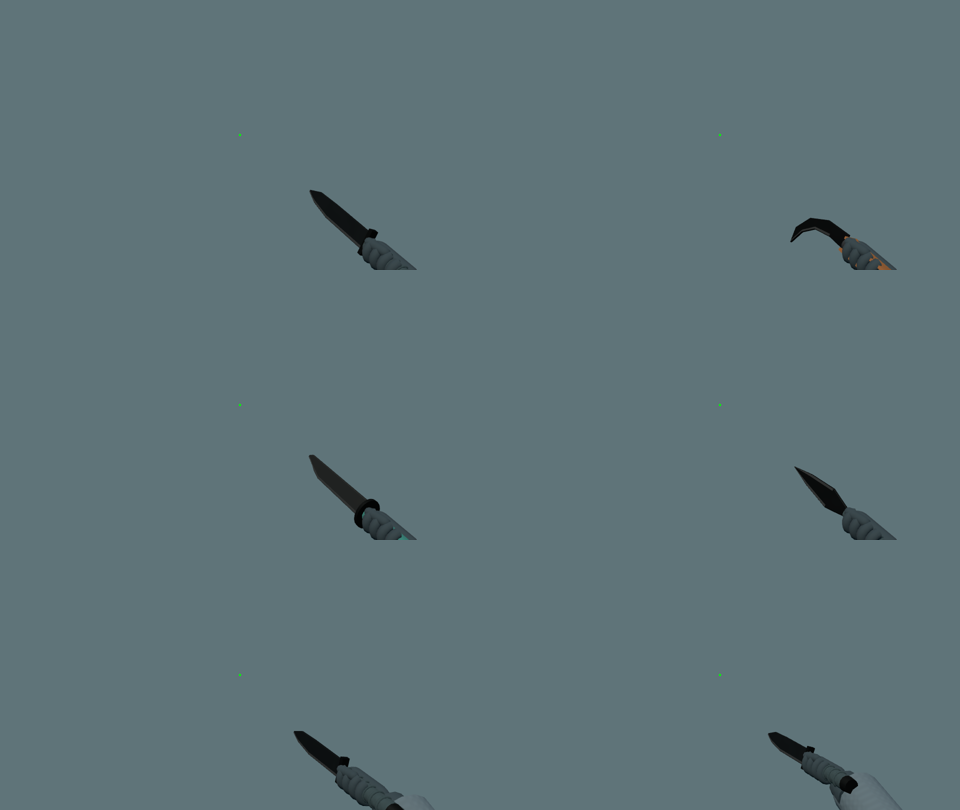
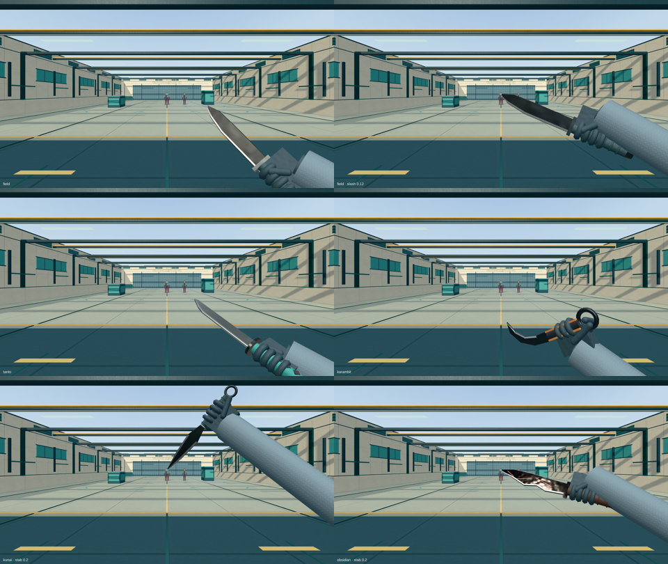

# 칼 파지와 겨누기 · 조사와 적용 (12.33)

작성일: 2026-11-27

## 1. 무엇을 바꿨나

| | 12.32까지 | 12.33 |
|---|---|---|
| 파지 | 칼 6종 모두 같은 파지. 칼날이 팔뚝과 일직선이라 손목 없이 꽂혀 있는 모양 | 칼마다 다른 파지 4가지. 손목이 꺾이고 팔뚝은 화면 오른쪽 아래에서 들어옴 |
| 카람빗 | 일반 칼처럼 정방향. 고리가 손잡이 끝에 매달림 | 검지를 고리에 끼운 역방향. 갈고리 날이 새끼손가락 아래로 나와 앞으로 휨 |
| 겨누는 자세 | 칼날 측면이 거의 보이지 않음 | 칼날 옆면이 보이고 날은 겨냥 방향을 향함. 칼끝은 조준점 쪽을 겨누되 조준점을 가리지 않음 |
| 공격과 판정 시점 | 판정은 누르는 즉시인데, 칼날이 약 0.1초 뒤 화면을 지나감 | 베기는 0.041초, 찌르기는 0.074초에 칼끝이 정확히 조준점에 닿음 |
| 베기 | 매번 같은 동작 | 3연속 베기가 방향을 바꿔 가며 반복됨 |
| 찌르기 | 작은 앞뒤 움직임 | 정방향은 조준선을 따라 찌르고, 역방향은 위에서 내려찍음 |
| 꺼내기 | 아래에서 올라오기만 함 | 카람빗은 검지를 축으로 한 바퀴 회전, 쿠나이는 정방향에서 역방향으로 뒤집기 |
| 달리기 | 작은 흔들림 | 발소리 보폭(1.6m)에 맞춰 팔을 흔듦 |
| 공격 중 팔 | 주먹을 축으로 팔 전체가 돌아 팔뚝이 허공에 뜸 | 팔꿈치를 화면 오른쪽 아래 밖에 고정해, 팔뚝이 늘 손목과 팔꿈치를 이음 |

위에서부터 필드 나이프(대기·베기 접촉), 탄토(대기), 카람빗(대기), 쿠나이(찌르기), 흑요석 송곳니(찌르기)입니다.

## 2. 조사

### 2.1 다른 FPS에서 호평받은 방식

**칼마다 다른 파지와 손동작 (카운터 스트라이크 계열)**
- 칼 종류마다 쥐는 법과 애니메이션이 달라, 칼이 수집 요소이자 손맛의 핵심이 됐습니다.
- 카람빗은 꺼낼 때 역방향으로 돌아 들어가고, 휜 날이 손 아래에 놓입니다.
- 고리에 낀 검지를 축으로 칼을 돌리는 동작이 대표적입니다.
- 이 게임의 칼 화면을 다시 구현한 공개 프로젝트([WebStrafe PR #51](https://github.com/yassinsolim/WebStrafe/pull/51))는 다음 기준을 실제로 적용했습니다.
  - 카람빗: 고리에는 엄지가 아니라 검지가 들어가고, 손등이 카메라를 향하며, 갈고리 날은 새끼손가락 아래로 앞을 향해 휩니다.
  - 푸시 대거: T자 손잡이를 가운뎃손가락과 약지 사이에 끼웁니다.
  - 검사 기준: 손가락이 칼 안에 들어가거나 칼날 중심선에서 7.5mm 안에 있으면 실패로 봅니다.

**공격 구성 (발로란트, 커뮤니티 정리)**
- 좌클릭은 세 번 베기가 반복되는 연속 공격이고, 우클릭은 한 번에 더 큰 피해를 주는 대신 회복이 긴 공격입니다. 피해는 정면 50·75, 뒤에서는 두 배입니다.
- 커뮤니티 측정에 따르면 좌클릭 애니메이션은 약 50ms이고, 휘두르는 소리 뒤 약 20ms 만에 판정이 들어갑니다.
- 즉 칼날이 보이는 순간과 판정이 거의 같고, 크게 휘두르는 예비 동작이 판정을 늦추지 않습니다.
- 이 수치는 검색 결과의 요약으로 확인했고, 원문 페이지(Liquipedia, The Spike)는 이 환경에서 열리지 않았습니다.

### 2.2 실제 칼 파지

| 파지 | 특징 |
|---|---|
| 정방향(망치) | 가장 흔한 파지. 칼날이 검지 쪽으로 나옴. 베기와 찌르기 모두 무난 |
| 세이버 | 엄지를 칼등에 올림. 손목을 꺾어 칼끝을 상대에게 겨눔. 조작이 정밀함 |
| 역방향(아이스픽) | 칼날이 새끼손가락 쪽으로 나옴. 엄지로 손잡이 끝을 덮으면 찌를 때 손이 미끄러지지 않음. 걸어 베기와 내려찍기에 쓰임 |
| 고리 파지 | 카람빗처럼 고리가 있는 칼. 검지를 고리에 끼워 놓쳐도 손에 남음 |

출처: 호신술·나이프 전문 매체의 파지 해설([Personal Defense Network](https://www.personaldefensenetwork.com/article/conventional-and-unconventional-knife-grips/), [RECOIL](https://www.recoilweb.com/knife-hands-avoid-these-common-grip-mistakes-to-sharpen-your-edge-weapon-skills-153220.html), [BladeForums](https://bladeforums.com/threads/ok-someone-please-define-the-grip-names.84417))

## 3. 분석과 적용 원칙

1. **칼 모양에 맞는 파지**
   - 필드 나이프, 에테르 블레이드, 흑요석 송곳니: 정방향
   - 탄토: 세이버(곧고 각진 날은 찌르기용)
   - 쿠나이: 역방향(고리 손잡이를 엄지로 덮음)
   - 카람빗: 고리 파지
   - 같은 공격이라도 파지에 따라 궤적이 달라, 칼을 고르면 손맛이 바뀝니다.
2. **겨누는 자세**
   - 대기 자세에서 칼끝은 조준점 쪽으로 기울이되, 화면 폭 기준으로 조준점에서 20% 이상 떨어뜨렸습니다(4:3·16:9·21:9 모두).
   - 날은 겨냥 방향을 향하고, 칼날 옆면이 보이게 해서 어떤 칼인지 한눈에 알 수 있습니다.
   - 찌르기는 이 자세에서 칼끝을 그대로 조준선을 따라 밀어 넣는 동작입니다.
3. **판정과 같은 순간에 닿는 칼날**
   - 판정은 누르는 순간 이미 정해집니다. 그래서 공격 동작은 예비 동작 없이 시작하고, 칼끝이 화면 중앙을 지나는 시점을 판정과 맞췄습니다(베기 41ms, 찌르기 74ms).
   - 칼끝 위치를 화면 좌표로 지정하고 주먹 위치를 계산해 맞추므로, 그 순간 칼끝이 조준점과 정확히 겹칩니다(오차 0.5% 미만).
4. **3연속 베기**: 0.85초 안에 이어 베면 다음 동작으로 넘어가고, 찌르기를 하거나 쉬면 처음으로 돌아갑니다.

   | 파지 | 1타 | 2타 | 3타 | 찌르기 |
   |---|---|---|---|---|
   | 정방향·세이버 | 오른쪽 위 → 왼쪽 아래 | 오른쪽 아래 → 왼쪽 위 | 수평 | 조준선을 따라 찌르기 |
   | 역방향·고리 | 수평으로 걸어 베기 | 위에서 아래로 걸어 베기 | 아래에서 위로 걸어 베기 | 위에서 내려찍기 |

5. **팔은 늘 붙어 있게**: 팔꿈치를 화면 오른쪽 아래 밖에 두고, 팔뚝이 매 프레임 손목과 팔꿈치를 잇게 했습니다. 크게 휘둘러도 팔뚝이 떠 보이지 않습니다.
6. **꺼내기 동작**
   - 0.6초 안에 끝납니다.
   - 카람빗은 고리를 축으로 한 바퀴 돌고, 쿠나이는 역방향으로 뒤집힙니다.
   - 장착이 끝나기 전에 마무리되므로 공격 가능 시점은 그대로입니다.

## 4. 바뀌지 않은 것

- 피해, 사거리, 회복 시간, 판정 방식, 이동 속도는 그대로입니다. 화면 표시만 바뀌어, 리플레이 호환에도 영향이 없습니다.
- **칼 살펴보기 동작**: 키 배정이 새로 필요해서 넣지 않았습니다. 원하시면 추가할 수 있습니다.

## 5. 검증

`src/tests/knife-handling-1233.test.ts`에서 다음을 확인합니다.
- 칼 6종의 파지 배정
- 카람빗 고리 안으로 검지가 지나가는지
- 역방향 칼날이 새끼손가락 바깥으로 나오는지
- 4:3·16:9·21:9 화면에서 대기 자세의 칼날이 화면 안에 있고 조준점을 가리지 않는지
- 모든 칼·모든 베기와 찌르기에서 접촉 순간 칼끝이 조준점에 닿는지(41ms·74ms 이내)
- 세 가지 베기가 모두 오른쪽에서 왼쪽으로 조준점을 지나고, 방향이 서로 다른지
- 찌르기가 칼끝을 앞으로 밀어 넣고, 공격이 끝나면 정확히 대기 자세로 돌아오는지
- 꺼낼 때 화면 아래에서 올라오는지
- 3연속 베기 순서(1-2-3-1, 쉬거나 찌르면 처음부터)
